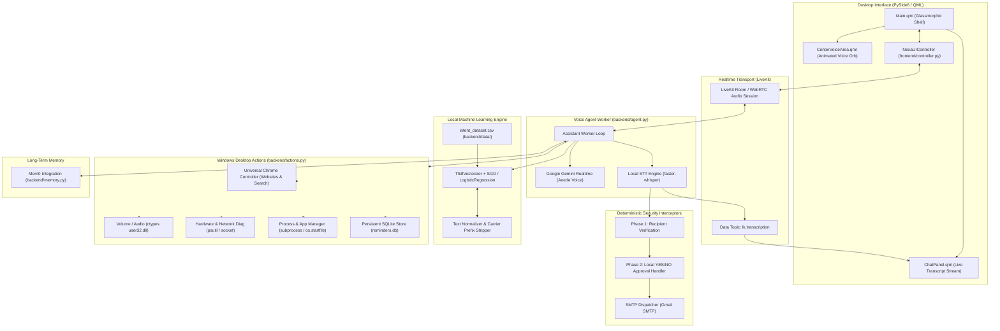

# 🧠 NEXA — Multimodal Voice AI Assistant for Windows

[-0078D6?logo=windows&logoColor=white)](#prerequisites)
[](#prerequisites)
[](#technology-stack)
[](#technology-stack)
[](#technology-stack)
[](#local-machine-learning-intent-engine)

NEXA is an intelligent, low-latency desktop voice assistant engineered for Microsoft Windows. It combines real-time WebRTC audio streaming through **LiveKit Agents** and **Google Gemini Realtime** with a native **PySide6 / Qt Quick (QML)** desktop interface and an offline **scikit-learn Machine Learning intent engine**.

NEXA executes desktop commands directly on Windows—including application control, hardware and network diagnostics, system volume adjustments, persistent SQLite reminders, universal Google Chrome website opening, and web searches—backed by a two-phase, fail-closed security architecture for email operations.

---

## Table of Contents

- [Architecture Overview](#architecture-overview)
- [Verified Core Features](#verified-core-features)
- [Technology Stack](#technology-stack)
- [Repository Structure](#repository-structure)
- [Prerequisites & System Requirements](#prerequisites--system-requirements)
- [Installation Guide (Windows PowerShell)](#installation-guide-windows-powershell)
- [Environment Configuration (.env)](#environment-configuration-env)
- [Local Machine Learning Intent Engine](#local-machine-learning-intent-engine)
- [Running NEXA](#running-nexa)
- [Voice Commands & Usage Examples](#voice-commands--usage-examples)
- [Security Architecture & Protections](#security-architecture--protections)
- [Automated Testing & Verification](#automated-testing--verification)
- [Feature Status: Implemented vs. Optional vs. Roadmap](#feature-status-implemented-vs-optional-vs-roadmap)
- [Troubleshooting & Common Issues](#troubleshooting--common-issues)
- [License & Contribution Guidelines](#license--contribution-guidelines)

---

## Architecture Overview

NEXA divides responsibilities across three decoupled layers:
1. **Frontend Desktop Shell**: A PySide6 / QML window providing a responsive voice orb, live bidirectional transcript rendering via WebRTC data streams, and hardware status indicators.
2. **Realtime Voice & Audio Pipeline**: LiveKit WebRTC handles full-duplex microphone and speaker audio, passing voice chunks to Gemini Realtime while a local `faster-whisper` worker transcribes audio client-side.
3. **Execution & Security Core**: A deterministic local router evaluates commands against a trained scikit-learn model, dispatching system actions through native Windows APIs (`ctypes`, `win32gui`, `psutil`) and isolating privileged tasks (such as email dispatch) behind explicit user confirmations.



---

## Verified Core Features

### 1. Real-Time Multimodal Voice Interaction
- Low-latency, full-duplex conversational voice powered by Google Gemini Realtime (`Aoede` voice preset).
- Bidirectional WebRTC audio communication managed through LiveKit Agents.
- Noise cancellation integration via `livekit-plugins-noise-cancellation`.
- Live client-side speech transcription published to the UI on the `lk.transcription` data topic.

### 2. Universal Website Opening in Google Chrome
- Opens any website, brand name, bare domain, or full URL in Google Chrome with natural language commands.
- Fast alias resolution for major services (`YouTube`, `Udemy`, `Spotify`, `Instagram`, `GitHub`, `Stack Overflow`, `Reddit`, `LinkedIn`, `ChatGPT`, `Netflix`, `Amazon`, `Wikipedia`, and more).
- Domain normalization: bare domains such as `stackoverflow.com` or `example.org` are automatically resolved to `https://`.
- Preserves complete URL paths, query parameters, and hash fragments (e.g., `https://github.com/trending?since=daily#today`).
- Uninstalled desktop app fallback: if an application like Spotify is not installed as a local Windows desktop client, NEXA gracefully launches its official web interface in Chrome.
- Security-first process execution: launches Chrome through `subprocess.Popen` with verified argument arrays—never using `shell=True`—to eliminate command injection vulnerabilities.
- Rejection of unsafe schemes: rejects `javascript:`, `file:`, `data:`, `about:`, `vbscript:`, and local file paths.
- Explicit error handling: returns a descriptive error if Google Chrome cannot be located on disk, rather than reporting silent success.

### 3. Web Search & Browser Navigation
- Voice-driven web searching with automatic query normalization: phrases like `"Search Google for Python interview questions"` extract pure query terms (`"Python interview questions"`).
- Dedicated YouTube video search queries (e.g., `"Search YouTube for lofi music"`).
- In-browser keyboard navigation using native Windows messages: supports commands such as `"scroll down"`, `"scroll up"`, `"go to top"`, `"go to bottom"`, and `"refresh"`.
- Numbered search result selection (e.g., `"open the first link"`, `"open the second result"`).

### 4. Two-Phase Fail-Closed Email Security (SEC-04)
- **Phase 1 (Recipient Verification)**: When an email drafting command is given, NEXA reads back the exact recipient address verbatim and halts staging until the user explicitly confirms or corrects the address. Corrections restart verification; LLMs cannot bypass this step.
- **Phase 2 (Final Local Approval)**: Once verified, the draft is staged in an in-memory session store. Sending requires an explicit local voice confirmation (`"yes"`). Saying `"no"` or `"cancel"` immediately discards the draft.
- **Fail-Closed Guarantees**: Gemini tool calls alone can **never** authorize SMTP transmission. Only the local approval handler holds the single-use token needed to trigger dispatch. Expired or altered drafts fail closed.

### 5. Windows Hardware & System Diagnostics
- CPU usage percentage across logical cores.
- RAM utilization (total, used in GB, and percentage).
- Battery percentage, charging status, and estimated runtime remaining.
- Storage drive discovery (free space, capacity, and low-disk warnings for drive `C:`, `D:`, etc.).
- Network health: ping latency, connection stability, active Wi-Fi SSID, and local/public IP addresses.
- System audio status: master volume levels, output devices, microphone availability, and camera status.

### 6. Desktop Control & Application Management
- Direct application launching: Notepad, Calculator, VS Code, Command Prompt, Windows Terminal, Paint, Task Manager, and others.
- Native volume control: muting, unmuting, increasing, and decreasing volume using native Windows `user32.dll` virtual key messages (`ctypes`).
- Application process inspection: lists open user applications, counts running instances, and identifies top memory consumers.
- Controlled application termination: terminates specific processes safely while rejecting requests targeting critical system executables.

### 7. Persistent Reminders & Timers
- Natural language time parsing (e.g., `"Remind me in 10 minutes to drink water"`, `"Set a timer for 5 minutes"`).
- Persistent SQLite storage (`backend/data/reminders.db`) ensuring reminders survive assistant restarts.
- Listing active reminders and cancelling individual or all pending reminders.

### 8. Long-Term Memory (Mem0)
- Contextual memory powered by Mem0 (`mem0ai`).
- Stores user preferences, facts, and conversation context across sessions.
- Voice commands for remembering facts (`"Remember that I prefer dark mode"`), querying memories, and deleting specific memories.

### 9. Multilingual Processing Engine
- Built-in support for multiple languages in `backend/voice.py`:
  - English (`en`)
  - Telugu (`te`)
  - Kannada (`kn`)
  - Hindi (`hi`)
  - Tamil (`ta`)
  - Malayalam (`ml`)
- Real-time language detection, translation to English for action routing, and response synthesis.

### 10. Native PySide6 Desktop Shell
- Frameless glassmorphic window designed for Windows 10 and 11.
- Animated dynamic voice orb visualizing listening, thinking, and speaking states.
- Live chat panel displaying real-time transcribed user utterances and assistant replies.
- High-DPI display scaling support.

---

## Technology Stack

| Category | Technology | Purpose in NEXA |
| :--- | :--- | :--- |
| **GUI Framework** | `PySide6` (Qt for Python 6) | Native Windows desktop window, event loop, and application shell |
| **UI Markup** | `Qt Quick / QML` | Fluid animations, voice orb canvas rendering, and chat transcript panel |
| **Voice Transport** | `livekit-agents`, `livekit` | Real-time WebRTC audio room streaming, participant tracking, data topics |
| **Voice Processing** | `livekit-plugins-noise-cancellation` | Background noise reduction for microphone input |
| **Multimodal LLM** | `livekit-plugins-google` (Gemini Realtime) | Voice-to-voice streaming intelligence with tool-calling capabilities |
| **Local STT** | `faster-whisper` | Fast local transcription of user voice audio for transcript streaming |
| **Intent Engine** | `scikit-learn`, `scipy` | TF-IDF feature extraction and local classification (`LogisticRegression`, `SGD`) |
| **System Diagnostics** | `psutil` | CPU, RAM, battery, disk space, and process monitoring |
| **Windows APIs** | `ctypes`, `pywin32` (`win32gui`, `win32process`) | Win32 virtual keys for volume, browser scrolling, and window handles |
| **Long-Term Memory** | `mem0ai` | Cross-session memory and user preference storage |
| **Automation Protocols**| `mcp` (Model Context Protocol) | Model Context Protocol SSE client for external workflow tool integration |
| **Database** | `sqlite3` (Python standard library) | Local persistent storage for reminders and timers (`reminders.db`) |
| **Email Protocol** | `smtplib` (Python standard library) | Secure SSL/TLS email dispatch via Gmail SMTP |
| **Configuration** | `python-dotenv` | Loads environment variables safely from `.env` |
| **Testing** | `pytest`, `unittest` | Asynchronous test execution and security audit suites |

---

## Repository Structure

```text
C:\Users\Hp\Desktop\Nexa\
├── .env.example                 # Template for environment configuration
├── .gitignore                   # Version control exclusions (credentials, models, dbs)
├── README.md                    # Project documentation
├── run.py                       # Main desktop launcher (GUI + optional background agent)
│
├── backend/                     # Python backend agent and execution engine
│   ├── actions.py               # Master action dispatcher, Windows APIs, Chrome navigation
│   ├── agent.py                 # LiveKit Agents worker loop & Gemini Realtime entrypoint
│   ├── memory.py                # Mem0 long-term memory integration
│   ├── prompts.py               # Persona instructions, tool routing guidance, and examples
│   ├── requirements.txt         # Core Python dependencies
│   ├── tools.py                 # Function tools exposed to Gemini (desktop actions, email, search)
│   ├── voice.py                 # Multilingual voice engine and language detection
│   │
│   ├── data/                    # Local training datasets and persistent stores
│   │   ├── intent_dataset.csv   # Labeled training dataset for local ML intent engine
│   │   └── reminders.db         # Persistent SQLite database for timers and reminders
│   │
│   ├── mcp/                     # Model Context Protocol client implementation
│   │   ├── __init__.py
│   │   ├── agent_tools.py       # MCP function tool decorator and registration
│   │   ├── server.py            # SSE client for connecting to MCP servers
│   │   └── util.py              # Tool schema parser and utility methods
│   │
│   ├── ml/                      # Machine learning intent classifier
│   │   ├── __init__.py
│   │   ├── classifier.py        # Model definition, vectorization, and confidence scoring
│   │   ├── evaluate.py          # Model evaluation (accuracy, precision, recall, F1)
│   │   ├── normalizer.py        # Carrier prefix removal, punctuation cleaning, lemmatization
│   │   └── train.py             # Script to train and export nexa_intent_model.pkl
│   │
│   └── models/                  # Generated model artifacts (git-ignored)
│       └── nexa_intent_model.pkl
│
├── frontend/                    # Native PySide6 / Qt Quick desktop shell
│   ├── __init__.py
│   ├── controller.py            # NexaUIController: bridges QML UI with Python backend
│   ├── livekit_client.py        # Frontend WebRTC room subscriber for transcript rendering
│   ├── main.py                  # PySide6 application initialization and High-DPI setup
│   │
│   ├── assets/                  # UI graphics and avatars
│   │   ├── assistant_avatar.png
│   │   ├── user_avatar.png
│   │   ├── background.png
│   │   └── background_clean.png
│   │
│   └── qml/                     # Qt Quick QML visual components
│       ├── Main.qml             # Primary application window layout
│       ├── CenterVoiceArea.qml  # Dynamic animated voice orb
│       ├── ChatPanel.qml        # Real-time transcript and message history
│       ├── LeftNavRail.qml      # Navigation sidebar and controls
│       └── TopSystemBar.qml     # Status bar (system resources, connectivity, window controls)
│
└── tests/                       # Automated unit and integration test suites
    ├── test_email_approval_flow.py          # Verifies Phase 2 email YES/NO local approval
    ├── test_email_recipient_verification.py # Verifies Phase 1 recipient verification flow
    └── test_website_opening.py              # Verifies Chrome website opening & URL resolution
```

---

## Prerequisites & System Requirements

Before setting up NEXA, ensure the host laptop meets the following specifications:

| Requirement | Specification |
| :--- | :--- |
| **Operating System** | Windows 10 (Build 19041+) or Windows 11 (64-bit required) |
| **Python Runtime** | Python 3.10.x or Python 3.11.x (tested with **Python 3.11.0 64-bit**) |
| **Browser** | Google Chrome installed at default Windows path (`Program Files` or `LocalAppData`) |
| **Audio Hardware** | Working microphone (input) and speakers or headphones (output) |
| **Network** | Broadband internet connection (required for WebRTC and Gemini streaming) |
| **C++ Build Tools** | Microsoft Visual C++ 14.0+ (required if compiling wheels for `psutil` or `scikit-learn`) |

### External Accounts & API Credentials Needed
1. **LiveKit Cloud**: A LiveKit Cloud project URL, API Key, and API Secret ([cloud.livekit.io](https://cloud.livekit.io/)).
2. **Google Gemini API**: A Google AI Studio API key with access to Gemini models ([aistudio.google.com](https://aistudio.google.com/)).
3. **Gmail App Password** *(Optional, for sending emails)*: A 16-character Google App Password generated with 2-Factor Authentication enabled.
4. **Mem0 API Key** *(Optional, for long-term cloud memory)*: An API key from [mem0.ai](https://mem0.ai/).

---

## Installation Guide (Windows PowerShell)

Follow these steps in a standard Windows PowerShell terminal:

### Step 1: Open Terminal and Navigate to Project
```powershell
# Navigate to the project root directory
Set-Location -Path "C:\Users\Hp\Desktop\Nexa"
```

### Step 2: Configure PowerShell Execution Policy
If script execution is disabled on your Windows machine, allow script execution for the current process:
```powershell
Set-ExecutionPolicy -ExecutionPolicy RemoteSigned -Scope Process -Force
```

### Step 3: Create and Activate Python Virtual Environment
```powershell
# Create a dedicated virtual environment named .venv
python -m venv .venv

# Activate the virtual environment
.\.venv\Scripts\Activate.ps1
```
*(Your terminal prompt should now be prefixed with `(.venv)`.)*

### Step 4: Upgrade Pip and Install Dependencies
```powershell
# Upgrade package manager
python -m pip install --upgrade pip setuptools wheel

# Install base Python packages from the requirements manifest
pip install -r backend/requirements.txt

# Install Windows OS and local STT dependencies (if not already present in environment)
pip install pywin32 faster-whisper
```

> [!NOTE]
> **Windows API and Speech Packages**:
> - `pywin32`: Required by `backend/actions.py` for native Windows window handles and in-browser keystroke navigation (`win32gui`, `win32process`, `win32con`).
> - `faster-whisper`: Required by `backend/agent.py` for client-side local speech-to-text processing (`WhisperModel`).
> If these are not already installed in your virtual environment alongside the requirements manifest, install them using `pip install pywin32 faster-whisper`.

### Step 5: Verify Critical Packages
Verify that the core libraries load properly in your virtual environment:
```powershell
python -c "import PySide6, livekit.agents, sklearn, psutil, win32gui, faster_whisper; print('All core libraries loaded successfully!')"
```

---

## Environment Configuration (.env)

NEXA reads credentials and runtime flags from a `.env` file located at the project root. A template is provided in `.env.example`.

### 1. Create Your `.env` File
```powershell
# Copy the example template to .env
Copy-Item -Path ".env.example" -Destination ".env"

# Open in Notepad to edit your credentials
notepad .env
```

### 2. Configuration Variables Reference

```env
# ==============================================================================
# LIVEKIT CLOUD WEBRTC CONFIGURATION (Required for voice streaming)
# ==============================================================================
LIVEKIT_URL=wss://your-project-id.livekit.cloud
LIVEKIT_API_KEY=your_livekit_api_key_here
LIVEKIT_API_SECRET=your_livekit_api_secret_here
LIVEKIT_AGENT_NAME=nexa-assistant
LIVEKIT_ROOM_NAME=

# ==============================================================================
# GOOGLE GEMINI & SEARCH CONFIGURATION (Required for assistant intelligence)
# ==============================================================================
GOOGLE_API_KEY=your_gemini_api_key_here
GOOGLE_SEARCH_API_KEY=your_optional_google_custom_search_key
GOOGLE_CSE_ID=your_optional_custom_search_engine_id

# ==============================================================================
# GMAIL SMTP CONFIGURATION (Required only for email dispatch)
# ==============================================================================
GMAIL_USER=your_email@gmail.com
GMAIL_APP_PASSWORD=xxxx xxxx xxxx xxxx

# ==============================================================================
# MEM0 LONG-TERM MEMORY (Optional)
# ==============================================================================
MEM0_API_KEY=your_mem0_api_key_here
USER_NAME=User
MEM0_TELEMETRY=false

# ==============================================================================
# OPTIONAL INTEGRATIONS & AUDIO SETTINGS
# ==============================================================================
N8N_MCP_SERVER_URL=https://your-n8n-instance.com/mcp/sse
N8N_WEBHOOK_URL=https://your-n8n-instance.com/webhook/
NEXA_STT_ENGINE=faster-whisper
NEXA_VOICE_BACKEND=livekit
```

> [!CAUTION]
> **Credential Hygiene**: Never commit the `.env` file to version control. The repository's `.gitignore` explicitly excludes `.env` and all credential patterns to protect your secrets.

---

## Local Machine Learning Intent Engine

NEXA uses a local machine learning intent engine for desktop actions. The model runs locally on your machine, eliminating latency and reducing API costs for routine operating system tasks.

- **Dataset**: `backend/data/intent_dataset.csv` contains labeled training utterances covering applications, system volume, hardware diagnostics, and reminders.
- **Model Pipeline**: `backend/ml/classifier.py` builds a `TfidfVectorizer` (sublinear TF scaling, n-gram range `1-2`) coupled with a `LogisticRegression` classifier.
- **Training Script**: `backend/ml/train.py` validates the dataset, evaluates train/test splits, and exports the serialized bundle to `backend/models/nexa_intent_model.pkl`.

### Training the Intent Model
To train or update the local model binary, run:
```powershell
python backend/ml/train.py
```
**Verified Output on Current Dataset (1,401 labeled samples)**:
```text
Training completed successfully.
Artifact saved: backend\models\nexa_intent_model.pkl
Training samples: 1120, Test samples: 281
Accuracy: 91.10%, Macro F1: 91.48%
```
*(Figures directly reflect the 80/20 train/test evaluation split in `backend/ml/train.py` on the 1,401 rows in `backend/data/intent_dataset.csv`.)*

---

## Running NEXA

NEXA supports three launch modes depending on whether you want the full graphical experience, a headless terminal worker, or a standalone UI.

### Mode 1: Unified Desktop Application (Recommended)
This launches the native PySide6/QML window and automatically spawns the LiveKit voice agent worker in a managed background subprocess:
```powershell
python run.py --with-agent
```
When you close the desktop window, the launcher automatically terminates the background voice agent worker cleanly.

### Mode 2: Voice Agent Worker in Development Mode
To run only the LiveKit voice worker in the terminal (useful for debugging Gemini Realtime interactions and reviewing live log streams):
```powershell
python backend/agent.py dev
```

### Mode 3: Desktop Shell Only
To inspect or debug the PySide6 / QML user interface without connecting to a background voice worker:
```powershell
python run.py
```

---

## Voice Commands & Usage Examples

Once connected, speak naturally into your microphone. Here are tested examples organized by capability:

### 1. Website Opening in Google Chrome
| Utterance | Executed Action |
| :--- | :--- |
| *"Open YouTube"* | Resolves alias and launches `https://www.youtube.com` in Google Chrome |
| *"Open Udemy in Chrome"* | Strips suffix and opens `https://www.udemy.com` in Chrome |
| *"Launch Spotify"* | Attempts local desktop client; falls back to `https://open.spotify.com` if not installed |
| *"Go to Instagram"* | Normalizes verb and opens `https://www.instagram.com` in Chrome |
| *"Open GitHub"* | Opens `https://github.com` in Chrome |
| *"Open stackoverflow.com"* | Normalizes bare domain to `https://stackoverflow.com` in Chrome |
| *"Visit https://github.com/trending"* | Preserves full URL, path, and parameters in Chrome |

### 2. Web & Video Search
| Utterance | Executed Action |
| :--- | :--- |
| *"Search Google for Python interview questions"* | Cleans query prefix and searches Google for `"Python interview questions"` |
| *"Search the web for machine learning tutorials"* | Cleans query prefix and searches Google for `"machine learning tutorials"` |
| *"Search YouTube for lofi hip hop"* | Opens YouTube search results for `"lofi hip hop"` |
| *"Scroll down"* | Sends Page Down keystroke to active browser window |
| *"Open the first link"* | Selects and opens result #1 from the active search session |

### 3. Hardware & Network Diagnostics
| Utterance | Response / Action |
| :--- | :--- |
| *"How much RAM am I using?"* | Returns exact memory in GB and current utilization percentage |
| *"What is my CPU usage?"* | Returns active processor load percentage across cores |
| *"How much battery is left?"* | Returns battery percentage, charging state, and time estimate |
| *"Which drive is running low on space?"* | Scans mounted partitions and reports drives exceeding safety thresholds |
| *"Am I connected to the internet?"* | Checks DNS ping latency and reports active connection status |
| *"What is my local IP address?"* | Reports active network adapter IP address |

### 4. Audio & Desktop Controls
| Utterance | Response / Action |
| :--- | :--- |
| *"Mute volume"* / *"Unmute volume"* | Sends native Win32 mute toggle message |
| *"Increase volume"* / *"Turn volume down"* | Adjusts master system audio level in Windows |
| *"Open Notepad"* / *"Launch Calculator"* | Launches native Windows utility executable |
| *"Open Chrome"* | Launches the Google Chrome desktop application executable |
| *"Close Notepad"* | Terminates running instances of `notepad.exe` |

### 5. Persistent Reminders & Timers
| Utterance | Response / Action |
| :--- | :--- |
| *"Remind me in 10 minutes to take my medicine"* | Stores persistent reminder in SQLite and starts countdown |
| *"Set a timer for 15 minutes"* | Initializes active countdown timer |
| *"Show my pending reminders"* | Lists upcoming active reminders and target times |
| *"Cancel all my reminders"* | Clears all pending reminders from the database |

### 6. Email Staging & Two-Phase Approval Flow
1. **User**: *"Send an email to john@example.com with subject Project Update saying the sprint is complete."*
2. **NEXA (Phase 1 — Recipient Verification)**:
   > *"I have received a request to email john@example.com. Please confirm: is john@example.com the correct email address?"*
3. **User**: *"Yes, that is correct."*
4. **NEXA (Phase 2 — Staging & Final Review)**:
   > *"I have prepared your email to john@example.com with subject 'Project Update'. Please review the draft: Recipient: john@example.com, Subject: Project Update, Body: the sprint is complete. Would you like me to send this email now? Please answer YES to send, or NO to cancel."*
5. **User**: *"Yes."*
6. **NEXA**:
   > *"Your email has been sent successfully."* *(Dispatched via Gmail SMTP with delivery confirmation)*

---

## Security Architecture & Protections

NEXA adheres to a **fail-closed security architecture** designed to ensure the model cannot make unapproved external modifications or leak sensitive credentials:

1. **Non-Bypassable Local Authorizations**:
   LLMs can hallucinate actions or misinterpret spoken instructions. Privileged operations (such as sending an email) require affirmative authorization processed locally in Python. Tool calls generated by the model cannot authorize SMTP dispatch.
2. **Deterministic Token Lifecycles**:
   Staged drafts are assigned a cryptographic single-use token tied to a session ID with a 5-minute time-to-live. Once evaluated or cancelled, the token is invalidated.
3. **Acoustic Recipient Verification**:
   To prevent misrecognitions in speech-to-text (e.g., mishearing a username or domain), candidate email addresses are read back verbatim and must be confirmed by the user before any draft is staged.
4. **Shell Injection Prevention**:
   All operating system process invocations (`chrome.exe`, native tools) use structured parameter lists passed directly to `subprocess.Popen` without `shell=True`.
5. **URL & Scheme Sanitization**:
   The website opening engine restricts schemes to `http` and `https`, disallowing local file access (`file://`) and script execution (`javascript:`).

---

## Automated Testing & Verification

The project includes an automated test suite verifying email approval flows, recipient verification, website opening, and regression safety.

### Running the Test Suite
Ensure your virtual environment is active, then execute:

```powershell
# Run the complete test suite
pytest tests/ -v
```

### Verified Test Suites

1. **`tests/test_website_opening.py` (12 Tests)**:
   - Verifies alias resolution (YouTube, Udemy, Spotify, Instagram, GitHub, etc.).
   - Tests bare domain normalization, path preservation, query strings, and localhost.
   - Verifies rejection of unsafe schemes (`javascript:`, `file:`, `data:`) and local file paths.
   - Tests `dry_run` simulation mode and confirms that process launching uses safe argument lists without `shell=True`.
   - Confirms that missing Chrome executables produce an explicit error instead of silent success.
   - Verifies search query normalization stripping engine prefixes.

2. **`tests/test_email_approval_flow.py` (11 Tests)**:
   - Proves that saying `"yes"` dispatches the exact staged draft once via SMTP.
   - Proves that saying `"no"` or `"cancel"` immediately cancels the draft with zero SMTP calls.
   - Confirms that LLM tool calls alone cannot trigger email dispatch.
   - Verifies prevention of duplicate dispatch and enforces token expiration.
   - Ensures structured logs contain no user credentials or email bodies.

3. **`tests/test_email_recipient_verification.py` (12 Tests)**:
   - Verifies that `send_email` in a live agent context refuses to stage without prior recipient confirmation.
   - Ensures candidate addresses are read back verbatim without heuristic distortion.
   - Confirms that address corrections update the candidate and require a new confirmation.
   - Validates cross-session isolation and fail-closed timeout expiration.

> [!NOTE]
> All automated tests mock external subprocesses, network requests, and SMTP connections. Running the test suite will **not** launch browser windows or transmit real emails.

---

## Feature Status: Implemented vs. Optional vs. Roadmap

### ✅ Fully Implemented & Verified
- LiveKit WebRTC real-time voice streaming with Gemini Realtime.
- PySide6 / QML desktop shell with animated voice orb and live chat panel.
- Local `faster-whisper` STT loop publishing to `lk.transcription`.
- Offline scikit-learn intent classifier with automated training pipeline.
- Universal Google Chrome website opening with alias resolution, domain normalization, and query preservation.
- Web search query extraction and in-browser scrolling control.
- Two-phase fail-closed email staging, recipient verification, and SMTP dispatch.
- Windows system monitoring (CPU, RAM, battery, drives, network, IP).
- System volume adjustments via native Win32 virtual keys (`ctypes`).
- Persistent SQLite timers and reminders (`backend/data/reminders.db`).
- Long-term memory integration via Mem0.

### ⚙️ Optional Integrations (Configured via `.env`)
- **Google Custom Search API**: Configurable via `GOOGLE_SEARCH_API_KEY` and `GOOGLE_CSE_ID` (falls back to DuckDuckGo if unset).
- **Mem0 Cloud Telemetry**: Configurable via `MEM0_API_KEY` for persistent memory.
- **n8n Automation Webhooks**: Configurable via `N8N_WEBHOOK_URL` and `N8N_MCP_SERVER_URL` for custom workflow automation.

### 🗺️ Future Roadmap
- Local offline LLM inference fallback using ONNX Runtime / llama.cpp.
- Global system push-to-talk hotkey hooks.
- Multi-monitor screen capture understanding.

---

## Troubleshooting & Common Issues

### 1. PowerShell Script Execution Blocked (`Activate.ps1`)
**Symptom**: Error: `File ...\Activate.ps1 cannot be loaded because running scripts is disabled on this system.`  
**Solution**: Run the following command in your PowerShell window:
```powershell
Set-ExecutionPolicy -ExecutionPolicy RemoteSigned -Scope Process -Force
```

### 2. LiveKit WebRTC Connection Timeouts
**Symptom**: The UI remains on `"Connecting..."` or the console reports connection errors.  
**Checks**:
- Verify `LIVEKIT_URL` starts with `wss://` (not `https://`).
- Check that your `LIVEKIT_API_KEY` and `LIVEKIT_API_SECRET` in `.env` match your LiveKit Cloud dashboard.
- Ensure your network allows outbound WebRTC (UDP ports 50000–60000 and TCP port 443).

### 3. Google Chrome Not Found When Opening Websites
**Symptom**: Assistant replies: `"Google Chrome is not installed or could not be found to open..."`  
**Solution**: Verify Google Chrome is installed in one of the standard Windows paths:
- `C:\Program Files\Google\Chrome\Application\chrome.exe`
- `C:\Program Files (x86)\Google\Chrome\Application\chrome.exe`
- `C:\Users\<User>\AppData\Local\Google\Chrome\Application\chrome.exe`

### 4. Gmail SMTP Authentication Error
**Symptom**: Assistant reports email sending failed due to an authentication error.  
**Solution**:
- Standard Google account passwords will **not** work. You must use a **Google App Password**.
- Visit [myaccount.google.com/apppasswords](https://myaccount.google.com/apppasswords), create an app password named "NEXA", and paste the 16-character token into `GMAIL_APP_PASSWORD` in `.env`.
- Ensure 2-Step Verification is enabled on your Google account.

### 5. Missing Local Intent Model Binary
**Symptom**: Warning logged: `ML intent model bundle not loaded or unavailable.`  
**Solution**: Run the training script to generate the model artifact from the dataset:
```powershell
python backend/ml/train.py
```

### 6. Audio Device Not Detected
**Symptom**: Assistant does not receive microphone audio or speaker output is silent.  
**Solution**: Ensure your microphone and output speakers are set as the **Default Communication Device** in Windows Sound Settings (`mmsys.cpl`).

---

## License & Contribution Guidelines

### License
No open-source license file is currently included in this repository. All rights are reserved by the project author. Unauthorized copying, distribution, or modification of these files is strictly prohibited unless explicitly granted by the author.

### Contribution Guidelines
1. Do not commit credentials, `.env` files, model binaries (`*.pkl`), or personal logs.
2. Ensure any new desktop action includes unit tests under `tests/` with mocked process calls.
3. Run the full test suite before submitting any changes:
   ```powershell
   pytest tests/ -v
   ```
